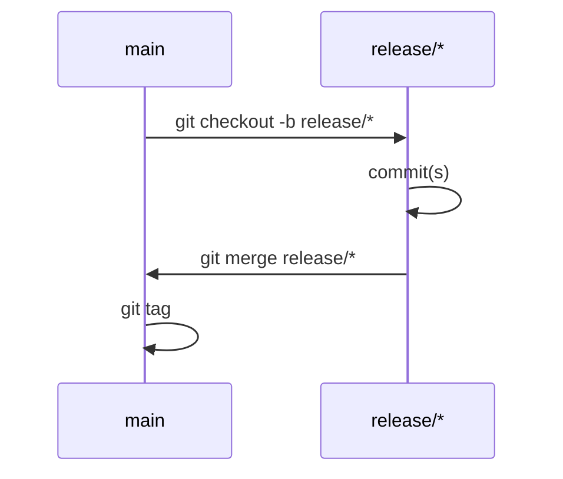

# cloud-tek/build

This repository contains 4 packages used internally by CloudTek:

- [CloudTek.Build](./docs/cloud-tek.build.md)
- [CloudTek.Build.Tool](./docs/cloud-tek.build.md#cloudtekbuildtool-cloudtek-build) (the `cloudtek-build` dotnet tool)
- [CloudTek.Testing](./docs/cloud-tek.testing.md)
- [CloudTek.Git](./docs/cloud-tek.git.md)

## Build process

## Test
